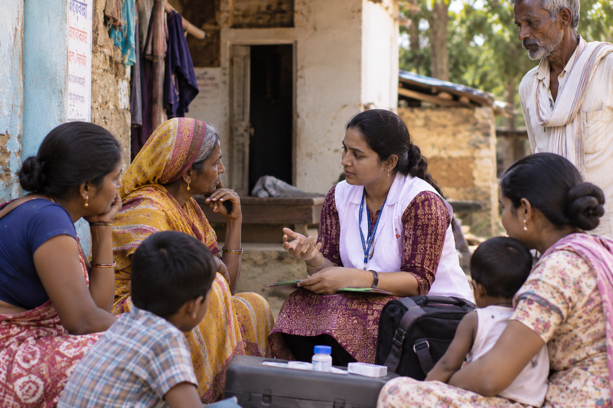
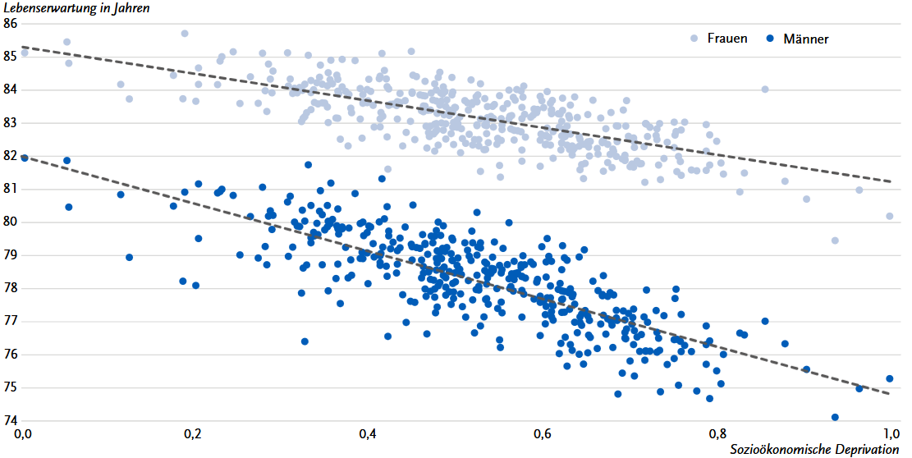

# Welcher Zweig der Medizin rettet die meisten Menschenleben?

---

---

## {.center}

> „Die medizinische Wissenschaft ist in ihrem innersten Kern und Wesen eine sociale Wissenschaft“

Berlin 1847 - Salomon Neumann

---

## Prävention ist...

* wirkmächtiger
* aufwändiger
* unklarer
* politiknäher
* wissenschaftlicher

**.. als Kuration**

---

## Wer bewirkt Prävention?

* Gestaltende der Lebenswelt
    * Politik
    * Wirtschaft
* Öffentlicher Gesundheitsdienst
* Public-Health Wissenschaft
* Nicht-Regierungs-Organisationen
* Krankenkassen

---

## Tätigkeiten
* Trink- und Badewassergesundheit
* Hygiene in Einrichtungen
* Infektionskrankheiten
* Sozialpsychiatrie bei Personen außerhalb des Systems
* Beratung zur Gesundheit von Kindern
* Beratung zu sexueller Gesundheit
* Gesundheitsstatistik

---

## Behörden
* Umständliche Prozesse
* Für alles ist eine gesetzliche Grundlage nötig
* Wenig Ressourcen (außer in Krisen dann zu viel)
* Risikoavers
* Politiknah

---

---

[2020 – 2022. Hoebel J im J Health Monit. doi: 10.25646/13003]{style="font-size: 60%;"}

---

## Konkret

* [Tätigkeit in einem der Gesundheitsämter in Berlin oder Brandenburg](https://tools.rki.de/plztool/)
* [Postgraduierten Ausbildung angewandte Epidemiologie am RKI](https://rki.de/pae)
* [Global Health am Zentrum für internationale Gesundheit](https://rki.de/zig)
* [Course Infectious diesease Epidemiology am RKI](https://www.rki.de/EN/News/Events-and-dates/Event-series/Infectious-Disease-Epidemiology/rki-course-infectious-disease-epidemiology-node.html)
* [Berlin School of Public Health](https://bsph.charite.de/)
* [Pandemic-Hub der WHO in Berlin](https://pandemichub.who.int/)
* [Nachwuchsnetzwerk öffentliche Gesundheit](https://noeg.org/)

---

## Vielen Dank! {.center style="text-align: center;"}

{fig-align="center" height="480px"}

[jakobschumacher.github.io/presentations]{style="font-size: 60%;"}
